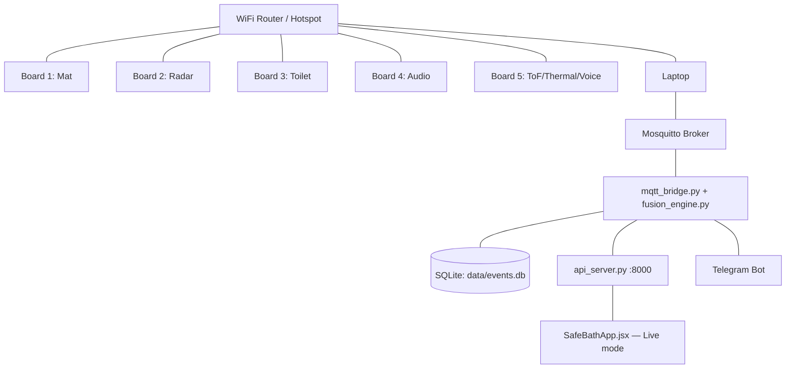

# SafeBath AI — Network Bring-Up & Fully Autonomous Build Guide
### Companion to `SafeBath_AI_Final_Master_Guide.md` — answers: how do I verify sensors, how does the network get built, and how does opencode run start-to-finish without stopping

---

## 0. The Key Reframe

Earlier phasing made physical hardware verification a **gate** — "don't move to Phase B until you've confirmed Phase A on real hardware." That's the right instinct for *your* hands-on bring-up, but it's the wrong shape for `opencode`, which can't plug in a board or press a Velostat cell itself. So this doc splits the work into two tracks that run in parallel, not in sequence:

- **Software track (opencode, fully autonomous):** writes and self-verifies every firmware file, backend service, and frontend integration in one continuous run — using a **simulated hardware publisher** instead of real sensors, so it never needs to wait on you.
- **Hardware track (you, whenever each board is physically ready):** flash the already-written firmware, verify with Serial Monitor, then watch the same dashboard opencode already built light up with real data instead of simulated data. No code changes needed to make that swap — that's the whole point of the MQTT contract.

---

## 1. Sensor Verification Workflow (Arduino IDE → Website)

This is the exact sequence for **each board**, every time, before trusting its data:

### Step 1 — Serial-only sanity check (no WiFi yet)
Every firmware file should support a compile-time debug flag:
```cpp
#define DEBUG_SERIAL_ONLY true   // flip to false once Step 1 passes

void loop() {
  // ...read sensors into local variables as normal...

  if (DEBUG_SERIAL_ONLY) {
    Serial.printf("gas=%d voc=%d turbidity=%lu\n", gasPpm, vocPpm, turbidity);
    delay(500);
    return;   // skip WiFi/MQTT entirely until this looks right
  }
  // ...WiFi + MQTT publish path below...
}
```
Upload, open Serial Monitor at 115200 baud, physically trigger each sensor (press the mat, breathe on the gas sensor, wave a hand at the ToF) and confirm the printed numbers respond sensibly. **Don't proceed until this looks right** — this is the one step that's genuinely worth pausing on, because no amount of downstream software can fix a sensor that's reading garbage.

### Step 2 — Flip to WiFi + MQTT, verify on the laptop
Set `DEBUG_SERIAL_ONLY false`, re-upload. On your laptop:
```bash
mosquitto -v                                    # watch the broker log every connection
mosquitto_sub -h localhost -t "sensor/#" -v      # watch every board's published payloads
```
Confirm you see the board connect (`New client connected from ...`) and its topic publishing on the expected schedule (Section 3 of the Final Master Guide has the rate per board).

### Step 3 — Confirm it reaches the backend
```bash
sqlite3 data/events.db "SELECT * FROM events ORDER BY ts DESC LIMIT 5;"
```
or once `api_server.py` is running:
```bash
curl http://localhost:8000/api/latest
```
You should see that board's latest reading in the JSON.

### Step 4 — Confirm it reaches the website
Open `SafeBathApp.jsx`, switch the top-bar toggle to **Live**, point the URL at `http://localhost:8000/api/latest`. That board's module card on the AI/Module Dashboard should update with real numbers within ~3 seconds (the poll interval) instead of the mock generator's simulated ones.

### Step 5 — Confirm danger actually notifies
Deliberately trigger a threshold from Section 7 of the Final Master Guide — press the mat hard and hold, or cover the ToF sensors with your hand. Confirm, in order: the module card turns watch/alert-colored → the event log shows the flagged event → (if high severity) the Voice Bridge audibly prompts → if you say nothing or say "help," the Telegram bot message arrives. If any link in that chain doesn't fire, that's exactly where to debug next — the chain is linear, so you'll always know which stage broke.

**Do this once per board as you bring it up**, and once more with all 5 running together at the end (Section 2.5 below).

---

## 2. How the Hardware Network Is Actually Built

### 2.1 Topology
Every board is a WiFi client of the same network your laptop is on — a plain star topology, no board talks to another board:



### 2.2 Network setup, once
1. **Use a dedicated router or phone hotspot**, not venue/home WiFi that you don't control — you need a stable, known IP for the laptop and no captive-portal weirdness.
2. Find the laptop's IP on that network: `ipconfig` (Windows) / `ifconfig` or `ip a` (Mac/Linux). This is the `mqtt_server` value every board's firmware needs.
3. **Reserve/assign the laptop a static IP or DHCP reservation** on the router so it doesn't change between demo sessions — nothing is more annoying than every board failing to connect because the laptop got a new IP overnight.
4. Install and start Mosquitto on the laptop (`mosquitto -v` to watch it live).

### 2.3 Per-board firmware config
Every `.ino` needs these three lines updated to match your actual network — this is the *only* thing that changes per deployment, everything else in the firmware is fixed:
```cpp
const char* ssid = "YOUR_ROUTER_SSID";
const char* password = "YOUR_ROUTER_PASSWORD";
const char* mqtt_server = "192.168.X.X";   // laptop's IP from Section 2.2 step 2
```

### 2.4 Building the network phase by phase (Phases A–E)
Each phase from the Final Master Guide's Section 10 is also a network bring-up step — you're adding one more client to the same broker each time, and confirming no collisions:

| Phase | Network state | What to check |
|---|---|---|
| A | Board 1 only powered, connected | `mosquitto_sub -t sensor/mat/#` shows only Board 1's traffic |
| B | + Board 2 | Broker log shows 2 distinct client connections; no topic overlap |
| C | + Board 3 | 3 clients; `sensor/toilet/reading` appears alongside the others |
| D | + Board 4 | 4 clients |
| E | + Board 5 | 5 clients; also confirm `voice/trigger` and `voice/reply` round-trip between Board 5 and Board 4 (this is the one topic pair that's genuinely cross-board — Board 5 publishes the trigger, Board 4 must be listening and reply within ~8s) |

Because every board uses a **unique MQTT client ID** (`MatNode1`, `RadarNode2`, etc. — already in the firmware) and publishes to its own topic namespace, there's no coordination needed between boards beyond "same WiFi, same broker address." You can power them on in any order, in any combination, and the broker handles concurrent connections fine.

### 2.5 Phase F — full network integration
Power on all 5 boards simultaneously. Checklist:
- `mosquitto -v` shows 5 active client connections.
- `mosquitto_sub -t "#" -v` shows a healthy interleaved stream from all 5 topic namespaces, no single board dominating or going silent.
- `mqtt_bridge.py` running and inserting all of it into `data/events.db` without schema-validation errors (Section 2 of the Software Build Spec — this is why `schemas.py` exists, so a malformed payload from one board fails loudly instead of silently corrupting `fusion_engine.py`'s math).
- `fusion_engine.py` running, computing a live risk score from the combined stream.
- `api_server.py` running, `curl localhost:8000/api/latest` returns a populated response.
- `SafeBathApp.jsx` in Live mode shows **all 7 module cards** updating with real data, the heatmap animating from the real Velostat scan, and the event log filling with real events.
- Trigger one deliberate "danger" condition (Section 1, Step 5) and confirm the full alert chain fires with all 5 boards live, not just the one you tested in isolation — cross-modal gates (Section 6.4 of the Software Build Spec, e.g. audio+radar gating) only matter once more than one board is actually running.

**This is the point where "connect all the hub, website shows live reading and is notified" is fully true** — nothing further needs to change in software once every board reaches this checklist.

---

## 3. Running opencode Fully Autonomously (no phase halts)

The blocker in the earlier plan was that each phase's "Definition of Done" required a **human** to physically verify hardware before opencode would be told to continue. Since opencode can't do that verification itself, the fix isn't to remove verification — it's to give opencode something it *can* verify on its own: a **simulated hardware publisher** that emits MQTT traffic matching the real contract exactly.

### 3.1 The unblocking piece: `backend/mock_publisher.py`
```python
"""
Publishes realistic, schema-correct MQTT traffic for all 5 boards, including
occasional deliberate 'danger' spikes, so the entire pipeline — broker,
mqtt_bridge, fusion_engine, alert_rules, api_server, frontend — can be built
and self-tested end-to-end with zero physical hardware connected.
Swap this off (or just don't run it) once real boards are on the network;
nothing downstream changes.
"""
import paho.mqtt.client as mqtt
import json, time, random

client = mqtt.Client()
client.connect("localhost", 1883)

def mat_frame(danger=False):
    vals = [random.randint(2800, 3800) if danger else random.randint(0, 400) for _ in range(64)]
    return ",".join(map(str, vals))

def radar_status(danger=False):
    return json.dumps({"presence": True, "motion": not danger, "stillness_ms": 130000 if danger else 500, "possible_collapse": danger})

def toilet_reading(danger=False):
    return json.dumps({"gas_ppm": 320 if danger else 205, "voc_ppm": 90 if danger else 40, "turbidity": 95 if danger else 50, "hour_of_day": time.localtime().tm_hour})

def tof_thermal(danger=False):
    return json.dumps({"avg_thermal_c": 24.6, "flow_pulses": 0, "tof_collapse": danger, "unattended_hot_fill": False})

AUDIO_LABELS = ["silence", "water", "impact_thud", "speech_or_cry"]

def loop():
    tick = 0
    while True:
        danger = (tick % 40 == 0 and tick > 0)   # inject a danger spike periodically
        client.publish("sensor/mat/frame", mat_frame(danger))
        client.publish("sensor/radar/status", radar_status(danger))
        client.publish("sensor/toilet/reading", toilet_reading(danger))
        client.publish("sensor/audio/event", json.dumps({"label": "impact_thud" if danger else random.choice(AUDIO_LABELS), "energy": 0.9 if danger else 0.1}))
        client.publish("sensor/tof_thermal/status", tof_thermal(danger))
        if danger:
            print(f"[mock_publisher] tick {tick}: injected danger spike")
        tick += 1
        time.sleep(1)

if __name__ == "__main__":
    loop()
```

### 3.2 The autonomous run command
```
opencode run "Read SafeBath_AI_Final_Master_Guide.md, SOFTWARE_BUILD_SPEC.md, and
SafeBath_AI_Network_And_Autonomous_Build_Guide.md in full.

Build backend/mock_publisher.py FIRST — this is what unblocks everything else.

Then implement every phase (firmware for all 5 boards, backend services,
frontend integration, tests) in one continuous run, without stopping between
phases and without waiting for my confirmation at any point.

Self-verify each phase like this instead of waiting for physical hardware:
run mock_publisher.py, confirm mqtt_bridge.py ingests it correctly, confirm
fusion_engine.py and alert_rules.py respond correctly to the injected danger
spikes, confirm api_server.py serves valid data, confirm it matches what
SafeBathApp.jsx expects. Use pytest for anything that can be asserted
programmatically instead of eyeballing output.

If you reach a step that genuinely requires a physical action only I can
do — flashing a board, soldering, pressing a real sensor — do NOT stop and
wait. Instead: write that action as a checklist item into NEXT_STEPS_FOR_YOU.md
with enough detail to act on later, and immediately continue to the next
piece of software work. Only stop entirely once every phase's software is
written, self-tested against the mock publisher, and NEXT_STEPS_FOR_YOU.md
is complete."
```

### 3.3 What this changes in practice
- opencode writes **all 5 firmware files, the full backend, and the frontend integration in one sitting** — nothing is blocked on you being present.
- Every backend piece gets proven correct against `mock_publisher.py`'s simulated traffic, including the danger-spike alert chain, before a single real board is even flashed.
- `NEXT_STEPS_FOR_YOU.md` becomes your actual to-do list — the physical actions (flash Board 1, verify via Serial Monitor, flash Board 2, ...) — separated cleanly from the software work, which is already done.
- When you do get to a board physically, Section 1's five-step verification workflow is what you personally walk through — swapping simulated data for real data is invisible to the rest of the system, because both speak the exact same MQTT contract.

**Bottom line:** opencode's job is "build and prove the software correct using simulated hardware," your job is "flash boards and confirm the simulation matches reality" — and neither has to wait on the other except at the very end, when all 5 boards are physically ready for the Phase F checklist in Section 2.5.
